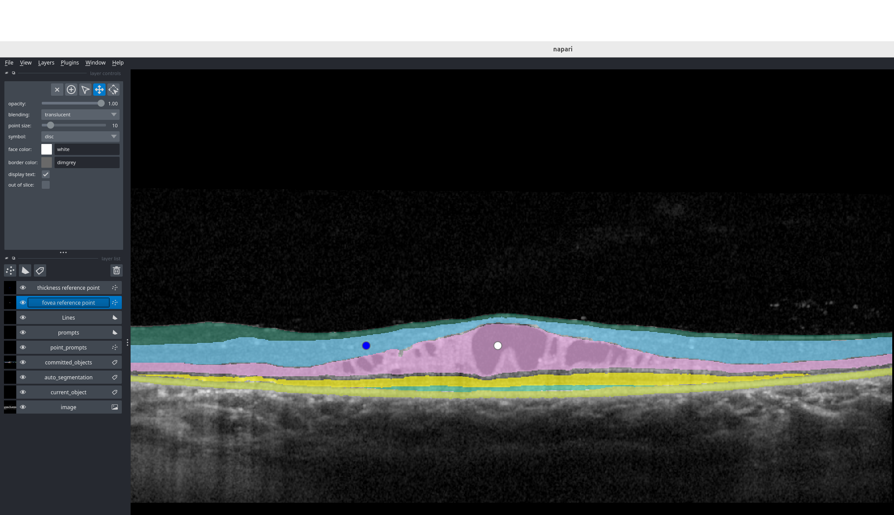
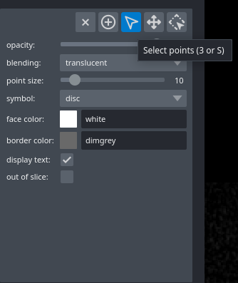
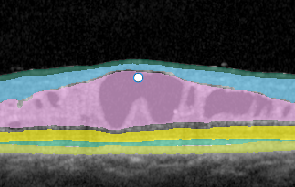
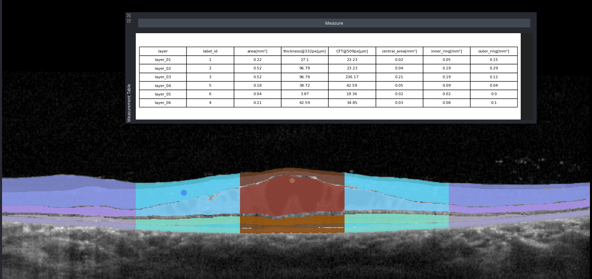
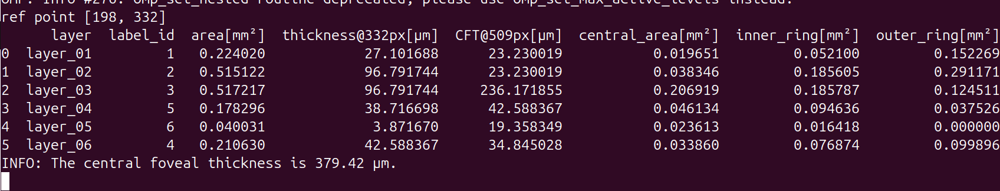
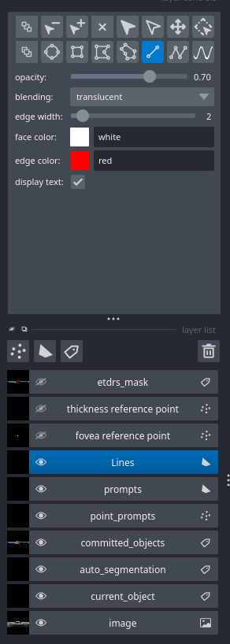
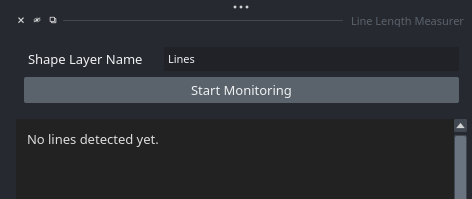
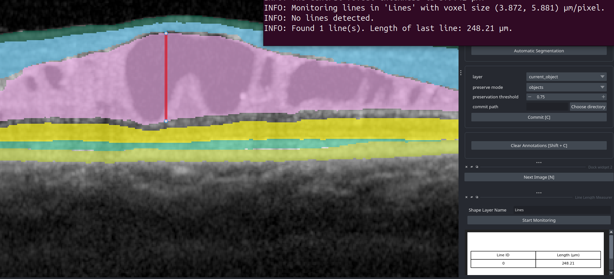

# Measure retinal layers

This guide opens a B-scan and its segmentation in napari.
Then it measures the central foveal thickness (CFT), the layer thicknesses at a reference point, the ETDRS-like areas, and manual distances.

You need:
- The `oct-sam` environment. See step 2 of [nnunet.md](nnunet.md) or [oct-sam.md](oct-sam.md).
- A B-scan and its segmentation, for example from step 6 of [nnunet.md](nnunet.md) or step 6 of [oct-sam.md](oct-sam.md).

Run the commands in the folder `oct-sam`, with the `oct-sam` environment active.

**Pixel size:** The napari measurement always uses the pixel size of the Heidelberg Spectralis: 3.87 µm axial and 5.88 µm lateral.
You cannot change it.
For a device with a different pixel size, the thicknesses and areas are not correct.
Use [`oct_tools.metrics -v`](#calculate-metrics-without-napari) for such data.

## 1. Open the B-scan and the segmentation

```bash
oct_tools.measure -i data/bscan.tif -s data/bscan_nnunet.tif -o data/measurement
```

- For the OCT-SAM segmentation, use `-i data/oct-sam/bscans/bscan_0.tif -s data/oct-sam/bscan_0.tif`.
- For a stack (TIF, H5 or VOL), add `-z <slice>` to select the B-scan. The default is the first B-scan.
- Add `--more_info` to also show the length and the thickness statistics of each layer.
- Add `--ref_position <x>` to set the start position of the thickness reference point.

**Result:** napari opens.
- The layer list on the left shows the layers `Image`, `Segmentation`, `fovea reference point` (white), `thickness reference point` (blue) and `Lines`.
- The right side shows the widgets **Measurement Table**, **Line Length Measurer** and **Label Color Map**.

The window of `oct_tools.interactive` (see [oct-sam.md](oct-sam.md)) has the same widgets and reference points.

## 2. Measure the central foveal thickness and ETDRS-like areas

1) In the **layer list** on the left, click the layer `fovea reference point`.



2) In the **layer controls**, select `Select points`.



3) Move the white point to the fovea.
If the B-scan does not show the fovea, delete the point.



4) In the **Measurement Table** widget on the right, click `Measure`.



**Result:** The widget shows the measurement table.
The terminal also shows the table.



- The column `CFT_total@<x>px[µm]` shows the CFT. The CFT is the thickness of the full retina at the fovea, from the top of the RNFL to the bottom of the RPE.
- The column `CFT@<x>px[µm]` shows the thickness of each layer at the fovea.
- `<x>` is the column of the fovea point in pixels.

## 3. Measure the layer thicknesses at a reference point

Move the blue point of the layer `thickness reference point` in the same way as the fovea point.
Put it on the position of interest and click `Measure` again.

**Result:** The column `thickness@<x>px[µm]` shows the thickness of each layer at the position `x` of the blue point.

## 4. Find the saved measurements

Each click on `Measure` also writes the table to `measurements.xlsx` in the output folder.
All measurements of a session accumulate in this one file.

```bash
ls data/measurement
```

**Result:** The folder contains `measurements.xlsx`.

## 5. Measure distances manually

1) Select the layer `Lines`. In the **layer controls**, select the tool `Add Lines`.



2) In the **Line Length Measurer** widget, type `Lines` into the box `Shape Layer Name`. Click `Start Monitoring`.
The widget now measures the length of each line that you draw in the layer `Lines`.



3) Draw a line.

**Result:** The widget table and the terminal show the length of the line.



## Measurement table

Each row of the table is one layer.

| Column | Value |
|---|---|
| `layer` | Name of the layer, from top to bottom: `layer_01`, `layer_02`, ... If no image column crosses all layers, the label ID. |
| `label_id` | Label ID in the segmentation |
| `area[mm²]` | Area of the layer in the B-scan |
| `CFT@<x>px[µm]` | Thickness of the layer at the fovea point |
| `CFT_total@<x>px[µm]` | Thickness of the full retina at the fovea point. The value is the same in each row. |
| `central_area[mm²]` | Area of the layer at a lateral distance of 0 to 0.5 mm from the fovea point |
| `inner_ring[mm²]` | Area of the layer at a lateral distance of 0.5 to 1.5 mm from the fovea point |
| `outer_ring[mm²]` | Area of the layer at a lateral distance of 1.5 to 3 mm from the fovea point |
| `thickness@<x>px[µm]` | Thickness of the layer at the thickness reference point |

The ETDRS grid is a circle grid with the diameters 1, 3 and 6 mm.
A B-scan is one line through this grid. Thus, the areas are the layer areas in the B-scan, on both sides of the fovea.
The fovea columns are only in the table if the fovea point exists.
The reference columns are only in the table if the thickness reference point exists.

With `--more_info`, the table also has these columns:

| Column | Value |
|---|---|
| `length[µm]` | Length of the layer along its center line |
| `max_thickness[µm]`, `min_thickness[µm]`, `mean_thickness[µm]`, `stdev_thickness[µm]` | Statistics of the thickness of the layer over all image columns |

`min_thickness[µm]` is `0.0` for a layer that does not cover the full width of the B-scan.

In `measurements.xlsx`, each row also has these columns:
- `file`: the name of the image file, without the extension.
- `z`: the index of the B-scan.
- `fovea_x` and `ref_x`: the positions of the two reference points.

The positions are not in the column names, for example `CFT[µm]` instead of `CFT@103px[µm]`. Thus, all rows of a session use the same columns.

## Calculate metrics without napari

`oct_tools.metrics` calculates the metrics of a segmentation without napari:
```bash
oct_tools.metrics -i data/bscan_nnunet.tif -o data/bscan_nnunet_metrics.xlsx
```

- `-i` is a segmentation in TIF or H5 format. In an H5 file, the command reads the first dataset that exists: `segmentation`, `seg`, `labels/edit_v3`, `labels/original`. It prints the name of the dataset if it is not `segmentation`.
- `-z` selects the B-scan in a stack. A file with a single B-scan needs no `-z`.
- `-o` is the output file. The extension `.tsv` or `.xlsx` selects the format.
- `-v` is the pixel size in µm, as `<axial> <lateral>`. The default is `3.87166976 5.8814`. A single value is used for both axes.
- `--fovea` is the column of the fovea in pixels. It adds the CFT and ETDRS-like columns.
- `--ref_position` is the column of the thickness reference point in pixels.
- `--etdrs_grid` is a TIF file for the ETDRS-like grid mask. It needs `--fovea`.

The table always contains the `--more_info` columns.

## Share annotations without napari

Reviewers without napari can look at the annotation with the `oct_tools.export_annotations` command:
```bash
# Two-channel ImageJ TIF. Fiji shows the annotation as an overlay that can be switched off.
oct_tools.export_annotations -i data/bscan.tif -s data/bscan_nnunet.tif -o data/bscan_overlay.tif

# Flat color overlay for any image viewer. A PNG holds a single B-scan, a TIF a whole stack.
# A segmentation of one B-scan from oct_tools.interactive needs the matching B-scan of the image stack.
oct_tools.export_annotations -i /path/to/HH-01.tif -s /path/to/output_folder/HH-01_31.tif -o /path/to/overlay.png --mode rgb -z 31
```

**Layer colors:**
- A segmentation file contains only the label IDs, not the colors. Plain napari, Fiji and other viewers use their own colors.
- Only `oct_tools.interactive`, `oct_tools.measure`, `oct_tools.open_labels` and `--mode rgb` show the layer colors.
  Their default color style is `custom`. Select a different style with `--color_style`.
- The composite TIF contains the label IDs in the second channel, without the layer colors.
  To share a whole stack with the layer colors, use `--mode rgb` with a TIF output.
- IDs 8 and higher are not valid layers. They get vivid warning colors.
  A layer that you commit in `oct_tools.interactive` can get such an ID.

## Compare segmentations with labels

`oct_tools.eval_segmentation` compares segmentations with manual labels:
```bash
oct_tools.eval_segmentation -d /path/to/h5_labels -s /path/to/segmentations --label_key edit_v3 --json evaluation.json
```

- `-d` is a folder of H5 files with the image and the labels.
- `-s` is a folder of segmentations. The segmentation of `<name>.h5` is `<name>.tif`.
- Add `--nnunet` for the NIfTI output of nnU-Net. The segmentation of `<name>.h5` is then `oct_<name>.nii.gz`.
- `--label_key` selects the label in `labels/`. The default is `original`.
- `--json` writes the values of each B-scan to a JSON file.

The command shows the precision, the recall, the F1 score and the symmetric best Dice score for each B-scan and their mean values.
- Precision, recall and F1 score count the layers that match a label layer with an intersection over union (IoU) of 0.5 or more.
- The symmetric best Dice score measures the overlap of the layers.
